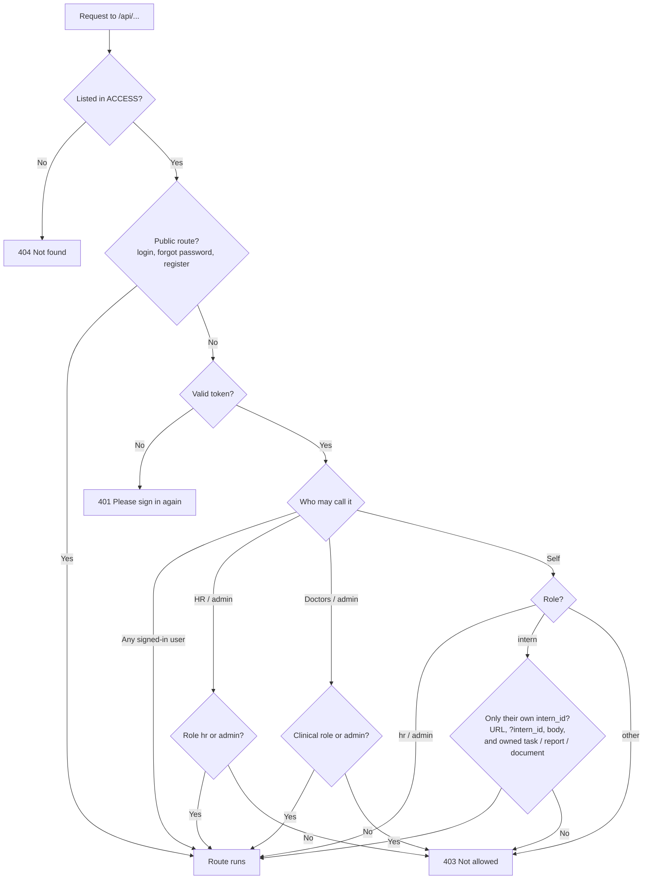
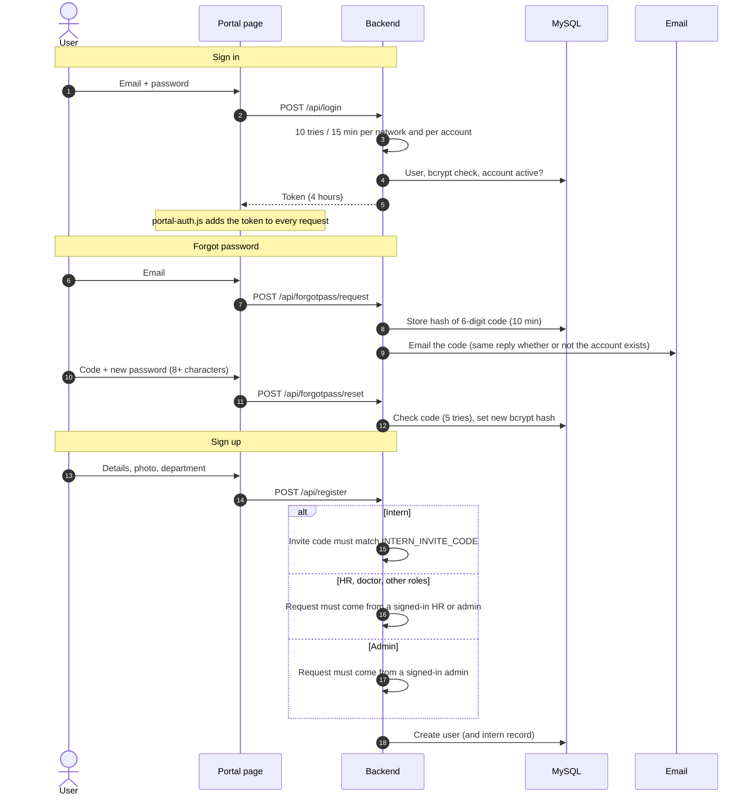
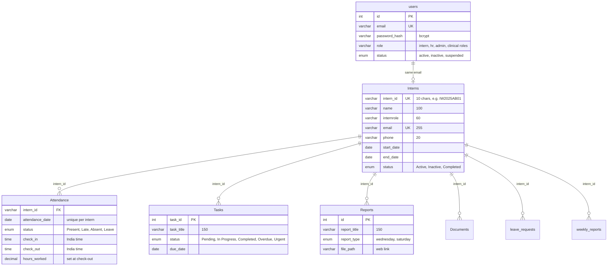

# InnerWhispers Portal Backend (HR, interns, doctors)

The API behind the HR portal (`/portal/hr/`) and the intern portal (`/portal/interns/`) on innerwhispers.in: sign-in, attendance, tasks, reports, documents, leave, notifications, HR finance pages, and the doctor/appointment records.

| | |
|---|---|
| **Live URL** | `https://interns-x9e4.onrender.com` |
| **Runs on** | Render (Node.js) |
| **Database** | MySQL on Hostinger |
| **Files** | Cloudinary (profile photos); documents and reports are stored as web links |
| **Live updates** | Socket.IO |

> This code used to live inside `public_html/portal/interns/`, which made it downloadable from the website. It now lives here and must **never** be uploaded to Hostinger.

---

## Access model

Every `/api` route is listed in the `ACCESS` table in `server.js` with who may call it. **Anything not listed is refused (404).** One gate (`accessGate`) runs before all routes.



| Who | Routes (examples) |
|---|---|
| **Public** | `POST /api/login`, `POST /api/forgotpass/request`, `POST /api/forgotpass/reset`, `POST /api/register` |
| **Any signed-in user** | `/api/profile`, notifications, dream reflection |
| **Self** (intern: own records only; HR: everyone) | attendance, check-in/out, tasks, reports, performance, leave requests, documents, own profile details and photo |
| **HR / admin** | HR dashboard, intern list, attendance records and edits, leave approval, report and document review, posting notifications, all finance pages, settings |
| **Doctors / admin** | appointments (incl. Aadhaar and addresses), patients, prescriptions, doctor dashboard |

Roles come from `users.role` (case and spaces ignored). Clinical roles: `psychiatry`, `psychology`, `therapy`, `counseling`, `guidance`, `doctor`.

**Adding a route:** add the route, then add a line to `ACCESS`. Until you do, it returns 404. For intern routes with an intern ID in the URL, set `{ own: n }` (the regex group); for records looked up by their own ID, set `{ check: ['Table', 'id_column'] }`.

---

## Sign-in, sign-up and password reset



---

## Security fixes in this version

| Was | Now |
|---|---|
| `/api/forgotpass` set anyone's password with just an email | Emailed 6-digit code, 10-minute expiry, 5 tries, rate-limited; old route returns 410 |
| Anyone could register as HR or admin | Interns need the invite code; other roles need an HR/admin login; admins need an admin |
| `/users` returned every user with password hashes | Removed |
| `/api/reports/download-file?path=` read any file on the server (including `.env`) | Removed; downloads only redirect to stored `http(s)` links |
| Patient appointments, Aadhaar, prescriptions open to anyone | Doctors and admin only |
| Finance, settings, documents, leave approval, tasks open to anyone | HR/admin, or the intern's own records |
| Interns could read or change other interns' data by changing an ID | Intern ID forced from the token; tasks, reports, documents checked for ownership |
| SQL injection in `/api/expenseSummary?category=` | Parameterised |
| Unlimited password guessing | 10 per 15 minutes per network and per account |
| CORS `*` | Allow-list (`ALLOWED_ORIGINS`) |
| Anyone could join the HR live-update room | Socket.IO requires a token; HR room for HR/admin; interns only their own room |
| Raw database errors sent to browsers | Generic messages; details only in logs |
| Email certificates not checked | Checked |
| Names, reasons and notes injected into email HTML | Escaped |
| Any field writable on the doctor dashboard (`SET ?`) | Only the known counters |
| Gemini endpoint open to anyone (costs money) | Signed-in users, 20 per hour |
| Any file type as a profile photo | JPG, PNG, WebP or GIF, 5 MB max |
| Weak or missing `SECRET_KEY` accepted | Server refuses to start unless it is 32+ characters |
| Demo `/upload` routes, debug route, duplicate `/health`, second `server.listen` | Removed |

**Known limits:** tokens are kept in the browser's `localStorage`, so a script injected into a portal page could read them; keep third-party scripts off portal pages. Rate limits are in memory (reset on restart, per instance). The doctor portal pages don't call this backend yet. The calendar service (`calander-q361.onrender.com`) is separate and wasn't reviewed.

---

## Intern data and dashboard numbers



**Automatic upgrades** (`upgradeInternSchema`, on every start, never deletes data): widens columns that were shorter than the forms allow (intern role "Full Stack Development" didn't fit; report titles over 50 characters failed), adds indexes for the dashboards' most common lists, and fills in `hours_worked` for past days.

**How the numbers are worked out** (`internScores`, used by the intern dashboard and the HR intern list):

| Number | Formula |
|---|---|
| Days attended | Present + Late |
| Attendance % | attended ÷ (attended + absent). Leave is excused and not counted against it. |
| Punctuality % | on time ÷ attended |
| Task completion % | completed tasks ÷ all tasks |
| Performance | average of attendance % (this month) and task completion %; attendance % alone if there are no tasks |

Previously absences *raised* the score, late days counted as nothing, the HR list showed 0% attendance and "Missing" reports for everyone, check-out times were saved in UTC (so hours were wrong), "In progress" couldn't be saved on a task, and finished tasks never showed as completed.

---

## Configuration

Set in **Render → Environment** (see `.env.example`):

| Variable | Required | Purpose |
|---|---|---|
| `SECRET_KEY` | **Yes** | 32+ random characters; signs logins. Changing it signs everyone out. |
| `INTERN_INVITE_CODE` | **Yes, for intern sign-up** | Code HR gives new interns. Without it, public intern sign-up is closed. |
| `ALLOWED_ORIGINS` | No | Default `https://innerwhispers.in,https://www.innerwhispers.in` |
| `DB_HOST`, `DB_PORT`, `DB_NAME`, `DB_USER`, `DB_PASSWORD` | Yes | Hostinger MySQL |
| `CLOUDINARY_CLOUDNAME`, `CLOUDINARY_API`, `CLOUDINARY_APISEC` | Yes | Profile photos |
| `BREVO_API_KEY` or `SMTP_*`, `SMTP_FROM`, `HR_EMAIL` | Yes | Emails (attendance, leave, reset codes) |
| `GEMINI_API` | No | Dream reflection |

---

## Testing

```bash
npm install
npm test
```

`test.js` starts the real server on a fake database and checks that: removed routes stay gone; the old password reset is refused; patients' records are doctors-only; nobody can self-register as HR/admin; the invite code and password length are enforced; interns can't read or write other interns' data or HR pages; the expense category is passed as a value (no SQL injection); unknown routes and forged tokens are refused; login is rate-limited; CORS refuses other sites.

---

## Deployment

1. **Rotate every secret first** (the old code exposed `.env`): Hostinger database password, Brevo key, Cloudinary API secret, `SECRET_KEY`, Gemini key.
2. Set `SECRET_KEY` (32+ characters) and `INTERN_INVITE_CODE` in Render.
3. Push this folder to the repository Render deploys from; run `npm test` first.
4. Upload the updated portal pages to Hostinger: every file in `public_html/portal/hr/` and `public_html/portal/interns/`, plus `public_html/portal/portal-auth.js` and `public_html/.htaccess`.
5. **Delete** `portal/interns/server.js`, `package.json` and `package-lock.json` from Hostinger's `public_html`.
6. Check: `https://innerwhispers.in/portal/interns/server.js` returns 403 or 404; sign in as an intern and as HR; try "Forgot password".

---

## Project structure

```text
.
├── server.js       All routes, the ACCESS table and gate, Socket.IO, emails
├── test.js         Security self-check (npm test)
├── package.json
├── .env.example    Every setting, no real values
└── .gitignore
```

© InnerWhispers Wellness LLP. All rights reserved. Proprietary and confidential.
